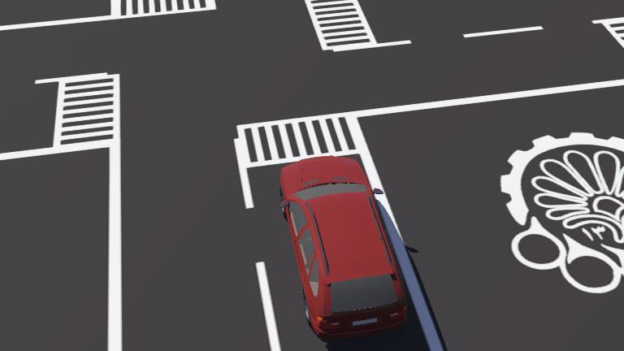
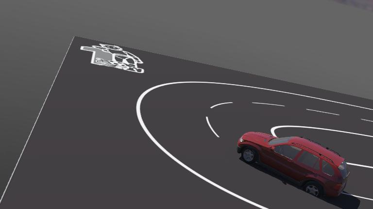
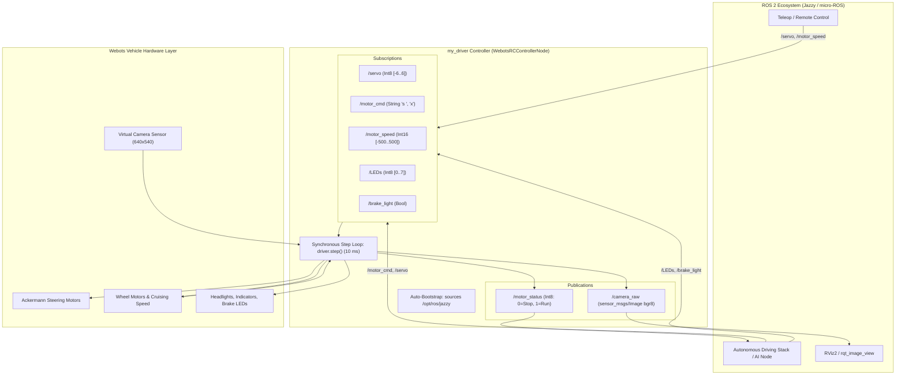

# Webots Autonomous RC Car — ROS 2 Digital Twin

[](https://cyberbotics.com/)
[](https://docs.ros.org/en/jazzy/)
[](https://www.python.org/)
[](https://ubuntu.com/)
[](LICENSE)

An end-to-end autonomous vehicle simulation in **Webots R2025a** integrated with **ROS 2 Jazzy**. This repository acts as an exact **Digital Twin** for physical RC car platforms running an **ESP32 micro-ROS motor controller** and an onboard **NVIDIA Jetson / Linux companion computer**.

---

## Table of Contents
- [Overview](#overview)
- [Simulation Worlds](#simulation-worlds)
- [System Architecture](#system-architecture)
- [Prerequisites & Dependencies](#prerequisites--dependencies)
- [Quick Start](#quick-start)
- [Control & Communication Interface](#control--communication-interface)
  - [Actuator Topics (Subscribers)](#actuator-topics-subscribers)
  - [Feedback & Perception Topics (Publishers)](#feedback--perception-topics-publishers)
- [Testing with ROS 2 CLI](#testing-with-ros-2-cli)
- [Directory Structure](#directory-structure)
- [Known Issues & Upstream Fixes](#known-issues--upstream-fixes)
- [License](#license)

---

## Overview

The vehicle model utilizes Ackermann steering geometry, realistic tire friction, calibrated roof camera optics, and a full automotive lighting suite (headlights, turn signals, emergency flashers, and brake lights).

### Key Features
- **Zero Interface Divergence**: Publishes and subscribes to the exact same topic names, data types, and numerical ranges as the real ESP32 micro-ROS firmware.
- **Calibrated Roof Camera**: $640 \times 540$ resolution with $1.2\text{ rad}$ FOV and $0.25\text{ rad}$ downward pitch mounted on `sensorsSlotTop`, streaming directly on `/camera_raw`.
- **Realistic Automotive Dynamics**: Physical friction layers, calibrated steering lock ($\pm 28.6^\circ$), speed scaling up to $\pm 25\text{ km/h}$, and automatic visual brake lights on deceleration.
- **Automated ROS 2 Bootstrapping**: Controller automatically sources `/opt/ros/jazzy/setup.bash` even when launched directly from the Webots desktop application menu.

---

## Simulation Worlds

The repository provides two simulation environments:

| City Mat World (`city_mat.wbt`) | Race Track World (`race.wbt`) |
| :---: | :---: |
|  |  |
| Urban autonomous navigation, lane keeping, intersections, road signage, and tight turns. | High-speed track testing, trajectory optimization, and aggressive cornering. |

Both worlds feature:
- Centered camera viewpoints (press **F1** in Webots to restore default vehicle tracking view).
- Invisible $1\text{ m}$ collision bedrock beneath the surface preventing vehicle ground drop or sinkage.
- Calibrated contact properties (`MatSurface` friction $\mu = 0.85 - 0.90$).

---

## System Architecture



---

## Prerequisites & Dependencies

1. **Operating System**: Linux Ubuntu 24.04 LTS (or compatible Debian-based distribution).
2. **Webots Simulator**: Webots R2025a or later.
   ```bash
   # Download and install from Cyberbotics official release
   https://github.com/cyberbotics/webots/releases
   ```
3. **ROS 2**: ROS 2 Jazzy Jalisco (or Humble / Iron).
   ```bash
   sudo apt update
   sudo apt install ros-jazzy-desktop python3-pip python3-numpy
   ```
4. **CV Bridge (Optional)**:
   ```bash
   sudo apt install ros-jazzy-cv-bridge
   ```
   *(Note: `my_driver.py` has a built-in pure NumPy fallback if `cv_bridge` is not installed).*

---

## Quick Start

### 1. Clone the Repository
```bash
git clone https://github.com/<your-username>/webots-rc-car-ros2.git
cd webots-rc-car-ros2
```

### 2. Launch Webots
Open either the **City Mat** or **Race Track** world:

```bash
# Sourcing ROS 2 first (recommended)
source /opt/ros/jazzy/setup.bash

# Launch City Mat world
webots worlds/city_mat.wbt

# OR launch Race Track world
webots worlds/race.wbt
```

When Webots starts:
- The `my_driver` controller initiates automatically.
- The roof camera feed is published immediately on `/camera_raw`.
- The vehicle headlights turn ON by default.

---

## Control & Communication Interface

### Actuator Topics (Subscribers)

| Topic | Type | Value Range | Function / Mapping |
| :--- | :--- | :--- | :--- |
| **`/servo`** | `std_msgs/msg/Int8` | `[-6 .. 6]` | Steering angle: `0` = Center, `-6` = Full Left ($-0.5\text{ rad}$), `+6` = Full Right ($+0.5\text{ rad}$). |
| **`/motor_cmd`** | `std_msgs/msg/String` | `'s <rpm>'`, `'x'` | Motor speed: `'s 200'` (Forward), `'s -150'` (Reverse), `'x'` (Emergency Stop & Brakes). |
| **`/motor_speed`** | `std_msgs/msg/Int16` | `[-500 .. 500]` | Direct numeric speed in RPM: negative = backward, positive = forward. |
| **`/LEDs`** | `std_msgs/msg/Int8` | `[0 .. 7]` | Lighting suite matching ESP32 firmware (see table below). |
| **`/brake_light`** | `std_msgs/msg/Bool` | `true` / `false` | Explicit toggle for rear red brake lights. |

#### `/LEDs` Command Codes
| Code | Action | Details |
| :---: | :--- | :--- |
| **`0`** | Turn Signals OFF | Cancels active left/right blinkers and hazards. |
| **`1`** | Left Blinker ON | Activates left turn indicator. |
| **`2`** | Right Blinker ON | Activates right turn indicator. |
| **`3`** | Hazard Flashers ON | Flashes both left and right blinkers simultaneously. |
| **`4`** | Headlights ON | Activates dipped beam headlights. |
| **`5`** | Headlights OFF | Deactivates headlights. |
| **`6`** | Brake Lights ON | Turns ON red rear brake lights. |
| **`7`** | Brake Lights OFF | Turns OFF red rear brake lights. |

### Feedback & Perception Topics (Publishers)

| Topic | Type | Frequency | Description |
| :--- | :--- | :--- | :--- |
| **`/camera_raw`** | `sensor_msgs/msg/Image` | Up to $100\text{ Hz}$ | Roof-mounted camera feed ($640 \times 540$, `bgr8`, `frame_id: camera_link`). |
| **`/motor_status`** | `std_msgs/msg/Int8` | $5\text{ Hz}$ | Vehicle heartbeat: `0` = Stopped / Idle, `1` = Moving. |

---

## Testing with ROS 2 CLI

Open a new terminal and source your ROS 2 environment:
```bash
source /opt/ros/jazzy/setup.bash
```

### 1. View the Camera Feed
```bash
ros2 run rqt_image_view rqt_image_view /camera_raw
```

### 2. Drive the Vehicle
```bash
# Move forward at 200 RPM (~10 km/h)
ros2 topic pub --once /motor_cmd std_msgs/msg/String "{data: 's 200'}"

# Steer left by 30°
ros2 topic pub --once /servo std_msgs/msg/Int8 "{data: -3}"

# Steer right by 30°
ros2 topic pub --once /servo std_msgs/msg/Int8 "{data: 3}"

# Center steering
ros2 topic pub --once /servo std_msgs/msg/Int8 "{data: 0}"

# Reverse at 150 RPM (~7.5 km/h)
ros2 topic pub --once /motor_cmd std_msgs/msg/String "{data: 's -150'}"

# Emergency Stop (Brakes applied automatically)
ros2 topic pub --once /motor_cmd std_msgs/msg/String "{data: 'x'}"
```

### 3. Operate Indicators and Lights
```bash
# Turn on left blinker
ros2 topic pub --once /LEDs std_msgs/msg/Int8 "{data: 1}"

# Turn on hazard emergency flashers
ros2 topic pub --once /LEDs std_msgs/msg/Int8 "{data: 3}"

# Turn off signals
ros2 topic pub --once /LEDs std_msgs/msg/Int8 "{data: 0}"

# Turn headlights ON / OFF
ros2 topic pub --once /LEDs std_msgs/msg/Int8 "{data: 4}"
ros2 topic pub --once /LEDs std_msgs/msg/Int8 "{data: 5}"

# Manual brake light toggle
ros2 topic pub --once /brake_light std_msgs/msg/Bool "{data: true}"
```

---

## Directory Structure

```text
.
├── .gitignore
├── README.md                            # Main project documentation
├── controllers/
│   └── my_driver/
│       ├── my_driver.py                 # Core ROS 2 vehicle controller node
│       └── README.md                    # Low-level controller technical documentation
├── docs/
│   └── images/
│       ├── city_mat.jpg                 # City Mat world screenshot
│       └── race.jpg                     # Race Track world screenshot
└── worlds/
    ├── city_mat.wbt                     # City Mat simulation world
    ├── race.wbt                         # Race Track simulation world
    └── textures/
        ├── city_mat.png                 # Ground surface texture for city
        └── race_track.png               # Ground surface texture for race track
```

---

## Known Issues & Upstream Fixes

### Webots R2025a `setIndicator` Typo
In Webots R2025a's standard Python vehicle binding (`lib/controller/python/vehicle/driver.py`), line 198 calls `Driver.api.wb_driver_set_indicator` instead of `wbu_driver_set_indicator`, causing an `undefined symbol` crash.
- [`my_driver.py`](controllers/my_driver/my_driver.py) includes an automatic runtime patch that detects and resolves this symbol mismatch seamlessly without requiring root library modifications.

### Audio Warnings
To prevent Webots from attempting to stream missing default vehicle engine audio samples (`sounds/engine.wav`), both world files explicitly declare `engineSound ""` on the vehicle model.

---

## License

This project is licensed under the Apache License 2.0. See the `LICENSE` file for details.
Webots vehicle models and standard PROTOs are copyright © Cyberbotics Ltd.
