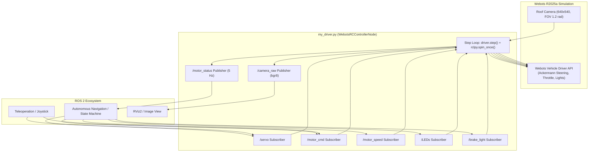

# Webots RC Vehicle ROS 2 Controller (`my_driver`)

## 1. Overview

The `my_driver` controller bridges the Webots R2025a vehicle simulation with **ROS 2 Jazzy**. It provides a 1-to-1 matching interface with the physical RC car platform (ESP32 micro-ROS robot controller and Jetson Orin companion computer).

---

## 2. Architecture & Execution Flow



### Simulation Loop
The controller runs synchronously with Webots' basic time step ($10\text{ ms}$ / $100\text{ Hz}$):
1. **`driver.step()`** advances the physical simulation by one time step.
2. **`publish_frame()`** grabs raw BGRA memory from Webots' virtual camera, extracts BGR channels, and publishes standard `sensor_msgs/msg/Image` frames.
3. **`publish_status()`** publishes vehicle motion state (`0` or `1`) at $5\text{ Hz}$.
4. **`rclpy.spin_once(timeout_sec=0)`** processes incoming ROS 2 control callbacks non-blockingly.

### Automatic Environment Bootstrapping
If Webots is launched from a desktop application menu or GUI shortcut where `~/.bashrc` and `/opt/ros/jazzy/setup.bash` are not inherited, the controller automatically detects the missing `rclpy`, sources the ROS 2 Jazzy environment, and re-executes itself preserving Webots IPC channels.

---

## 3. Topics & Message Interface

### 3.1 Actuator Subscriptions

| Topic | Type | Input Range / Format | Description |
| :--- | :--- | :--- | :--- |
| **`/servo`** | `std_msgs/msg/Int8` | `[-6 .. 6]` | Steering control (0 = center, -6 = full left, +6 = full right). |
| **`/motor_cmd`** | `std_msgs/msg/String` | `'s <rpm>'`, `'x'`, `'r'` | String motor commands matching micro-ROS (`s 200`, `x` for emergency stop). |
| **`/motor_speed`** | `std_msgs/msg/Int16` | `[-500 .. 500]` | Direct motor RPM input (negative = backward, positive = forward). |
| **`/LEDs`** | `std_msgs/msg/Int8` | `[0 .. 7]` | Turn signals, hazard blinkers, headlights, and brake lights. |
| **`/brake_light`** | `std_msgs/msg/Bool` | `true` / `false` | Dedicated toggle for rear brake lights. |

### 3.2 Sensor & Feedback Publications

| Topic | Type | Frequency | Description |
| :--- | :--- | :--- | :--- |
| **`/camera_raw`** | `sensor_msgs/msg/Image` | Up to $100\text{ Hz}$ | Roof camera frame ($640 \times 540$, `bgr8`, `camera_link`). |
| **`/motor_status`** | `std_msgs/msg/Int8` | $5\text{ Hz}$ | `0` = Stopped / Idle, `1` = In Motion. |

---

## 4. Input Mapping Details

### 4.1 Steering Mapping (`/servo`)
The physical servo discrete positions $[-6, 6]$ are linearly mapped to Webots' wheel knuckle angle:
$$\theta = \left(\frac{\text{val}}{6.0}\right) \times 0.5\text{ rad} \approx \pm 28.65^\circ$$
- **`-6`**: Full Left turn ($-0.50\text{ rad}$)
- **`0`**: Straight forward ($0.0\text{ rad}$)
- **`+6`**: Full Right turn ($+0.50\text{ rad}$)

### 4.2 Motor Velocity Mapping (`/motor_cmd` & `/motor_speed`)
The RPM range $[-500, 500]$ is scaled to Webots vehicle cruising speed $[-25, 25]\text{ km/h}$:
$$v_{\text{km/h}} = \left(\frac{\text{RPM}}{500.0}\right) \times 25.0\text{ km/h}$$
- **Positive RPM**: Drives Forward.
- **Negative RPM**: Drives Backward (Reverse).
- **Stop Command (`x`) or `0 RPM`**: Actuates mechanical brakes (`driver.setBrakeIntensity(1.0)`) and sets cruising speed to `0`.

### 4.3 Lighting Control (`/LEDs`)
Matches the ESP32 state node protocol:

| Command | Action | Webots Vehicle API Call |
| :---: | :--- | :--- |
| **`0`** | Turn signals OFF | `driver.setIndicator(INDICATOR_OFF)`, `driver.setHazardFlashers(False)` |
| **`1`** | Left blinker ON | `driver.setIndicator(INDICATOR_LEFT)` |
| **`2`** | Right blinker ON | `driver.setIndicator(INDICATOR_RIGHT)` |
| **`3`** | Hazard flashers ON | `driver.setHazardFlashers(True)` |
| **`4`** | Headlights (dipped beams) ON | `driver.setDippedBeams(True)` |
| **`5`** | Headlights OFF | `driver.setDippedBeams(False)` |
| **`6`** | Brake lights ON | `driver.setBrakeIntensity(1.0)` |
| **`7`** | Brake lights OFF | `driver.setBrakeIntensity(0.0)` |

---

## 5. Command Cheat Sheet (CLI Testing)

Before running commands, ensure your ROS 2 environment is sourced:
```bash
source /opt/ros/jazzy/setup.bash
```

### Drive Forward at 200 RPM:
```bash
ros2 topic pub --once /motor_cmd std_msgs/msg/String "{data: 's 200'}"
```

### Drive Backward at 150 RPM:
```bash
ros2 topic pub --once /motor_cmd std_msgs/msg/String "{data: 's -150'}"
```

### Steer 30° Left:
```bash
ros2 topic pub --once /servo std_msgs/msg/Int8 "{data: -3}"
```

### Center Steering:
```bash
ros2 topic pub --once /servo std_msgs/msg/Int8 "{data: 0}"
```

### Emergency Stop (Applies Brakes):
```bash
ros2 topic pub --once /motor_cmd std_msgs/msg/String "{data: 'x'}"
```

### Turn On Left Turn Signal:
```bash
ros2 topic pub --once /LEDs std_msgs/msg/Int8 "{data: 1}"
```

### Turn On Hazard Flashers:
```bash
ros2 topic pub --once /LEDs std_msgs/msg/Int8 "{data: 3}"
```

### Turn Off Signals:
```bash
ros2 topic pub --once /LEDs std_msgs/msg/Int8 "{data: 0}"
```

### View Live Camera Feed:
```bash
ros2 run rqt_image_view rqt_image_view /camera_raw
```
